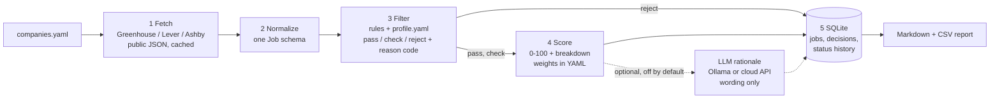

# jobgate

**Who it's for:** new graduates who run into sponsorship, work-permit and location blockers and want to skip those postings quickly.

jobgate is an open-source job search helper for new graduates. It reads **public** job
postings from ATS job boards (Greenhouse, Lever, Ashby), drops the ones with application
blockers up front (visa, citizenship or clearance, video or take-home requirements, years of
experience, language, location, time zone), and ranks the rest 0-100 with a reason for every
number.

**It never applies for you.** There is no auto-apply and there will not be one. You read
the shortlist and submit applications yourself.

> **Status: early development.** The whole pipeline runs from the command line. The filter's
> accuracy has not been independently verified yet, so this README makes no accuracy claim.
> See [Limitations](#limitations).

## The problem

New-grad search means opening hundreds of postings only to find, three paragraphs down,
"no visa sponsorship", "must hold a security clearance", "5+ years", or "record a video
introduction". jobgate reads those sentences for you, tells you which rule fired and why,
and sorts what is left. When a posting is unclear or contradicts itself it says **check**
instead of silently throwing it away.

## Set up in 10 minutes

You need Python 3.12 or newer and git. Nothing else, and no account or API key.

```bash
git clone https://github.com/huseyinbuyukbayram1/jobgate.git
cd jobgate
python3 -m venv .venv && source .venv/bin/activate    # macOS / Linux
pip install -e .                             # about 10 seconds
jobgate --version                            # prints the installed version

cp profile.example.yaml profile.yaml         # then edit it: see "Your profile" below
cp companies.example.yaml companies.yaml     # 10 public company boards to start with
jobgate companies validate                   # OK: 10 companies, 10 active (...)

jobgate run                                  # fetch -> filter -> score -> report
```

**Windows:** the steps are the same, but create and activate the environment with
`py -m venv .venv` and then `.venv\Scripts\Activate.ps1` (PowerShell) or
`.venv\Scripts\activate.bat` (cmd); use `copy` instead of `cp`. I have only run this on macOS, so
the Windows route is untested.

`jobgate run` takes about a minute for the 10 example companies (it waits between requests on
purpose). Then open `reports/report.md`, or `reports/report.csv` in a spreadsheet.

After you apply to something, or decide it is not for you:

```bash
jobgate mark aca9de60 applied        # the id is printed in the report
jobgate mark 6c501ff2 dropped --note "needs on-site"
```

Running any command twice never creates duplicates, and the second `jobgate run` re-uses
the day's fetch cache instead of hitting the job boards again.

### Check one posting you found elsewhere

Paste a posting into `jobgate check` (from a file or on stdin) to see what the filter rules say
about it. It uses your `profile.yaml`, needs no network, no database and no LLM, and does not
score or store anything:

```bash
pbpaste | jobgate check --title "Backend Engineer" --location "Dublin, Ireland"
jobgate check posting.txt --location "Berlin, Germany"
```

```text
Verdict: reject
  - VISA_NO_SPONSORSHIP (reject): We are unable to sponsor visas.
  - LOCATION_OUTSIDE_PROFILE (reject): New York, NY
```

`--title` feeds the seniority rule and `--location` the location rule; without `--location` that
rule is skipped and the output says so. Global options such as `--profile` go before the command.

### Your profile

`profile.yaml` (git-ignored; start from the fictional `profile.example.yaml`) says where you may
work, which languages you speak, how many years of experience is too much, and what you want.
The filter reads everything above `preferences`; the score reads `preferences`. An abridged
example (the full commented file is `profile.example.yaml`):

```yaml
work_authorization:
  regions: [germany, ireland, eu]       # where you may work without sponsorship
citizenships: [german, eu]
security_clearance: false
max_experience_years: 2                 # reject postings that ask for more
languages: [english, german]
student_status: graduated               # optional: graduated | enrolled
graduation_year: 2026                   # optional: reject postings that ask for another year
locations:
  allowed: [germany, berlin, ireland, dublin, europe, eu]
blockers:
  video_requirement: reject             # reject | ignore
  take_home_assignment: reject
preferences:                            # used only by the score
  target_roles: [software engineer, backend engineer]
  technologies: [python, sql, docker]
  work_modes: [remote, hybrid]
```

Scoring weights live in YAML too: copy `scoring.example.yaml` to `scoring.yaml`.

### Role matching

The role part of the score (30 points by default) compares the **title** with your
`target_roles`. The title is normalised first (lower case, punctuation removed, "engineering" and
"engineers" read as "engineer", `role_synonyms` such as "member of technical staff", "developer"
or "swe" rewritten to "software engineer"), then split at " - ", commas and brackets into a first
part ("Software Engineer") and later parts (a team or place). The best tier wins:

| The title has | Share of the role points |
|---------------|--------------------------|
| the whole target phrase in the first part ("Software Engineer, Payments") | all |
| all its words in the first part, in any order ("Software Quality Engineer") | 0.9 |
| the whole phrase in a later part ("Platform Lead - Software Engineer") | 0.8 |
| at least half of its words in the first part ("Backend Engineer"), but never more than 0.75 | that share |

Words in a team name never count as a partial match, and a word from `avoid_roles` ("sales") sets
the role points to 0. The report says which match counted (`role match: ...`, also in the CSV
column `role_match`). The synonym list is in `scoring.example.yaml` and is also the built-in
default; a `role_synonyms` section in your `scoring.yaml` replaces it. Synonyms apply to the first
part of the title only, and not before words such as "relations" or "platform" ("Developer
Relations" is not a developer job). Weights still add up to 100 and nothing here changes a filter
verdict.

## Example output

A real run with the example profile and the 10 example companies (public postings, trimmed):

```text
$ jobgate run
Fetched 2277 postings from 10 of 10 companies (2277 new, 0 no longer listed).
Filtered 2277 postings: 23 pass, 122 check, 2132 reject.
Scored 145 postings.
Wrote reports/report.md and reports/report.csv.
  94 postings with a low role match (role 0) are listed apart in the report.
```

`reports/report.md` has four sections: **Ranked matches**, **Needs a check** (each with the
sentence that made the filter unsure), **Low role match** and a count of **Rejected** postings per
reason code. A posting that passed the filter, or needs a check, but whose title matches none of
your `target_roles` (role score 0) is listed under **Low role match**, with its score and
breakdown (and the filter's reasons, if it needs a check), instead of under Ranked matches or
Needs a check. In this example run that moved 23 postings that passed (sales, account,
recruiting and design roles, so Ranked matches was empty) and 71 that needed a check. The 51 left
under **Needs a check** are mostly engineering-style titles, and all of them are from one company
whose location field was vague. The numbers change every day because the
boards change; the shape does not. The CSV has the same split in its `section` column
(`ranked`, `check`, `low_role_match`) and a `role_points` column; the `verdict` column still says
`pass` or `check`.

An entry under **Needs a check** looks like this (the line starting with `-` is the reason and
the sentence behind it):

```markdown
### 1. 77: role 30, technology 30, level 10, location 7 — [Software Engineer](https://boards.greenhouse.io/cloudflare/jobs/8212060?gh_jid=8212060)
Cloudflare · Hybrid · posted 2026-09-18 · id `aca9de60` · status: found · role match: phrase "software engineer"

- LOCATION_UNCLEAR: Hybrid
```

`77: role 30, technology 30, level 10, location 7` reads as: 77 out of 100, made of 30 role
points, 30 technology points, 10 level points and 7 location points (parts that scored zero are
left out, except in **Low role match**, where `role 0` is always shown). `role match:` names the
title match that earned the role points (here the whole phrase of your target role); see
[Role matching](#role-matching).

## How it works



Every decision is **rule-based**. The optional LLM (see below) only adds a sentence of wording
and cannot change a verdict or a score. More detail: [docs/architecture.md](docs/architecture.md).

### Reason codes

A rejected or "check" posting always carries a reason code and the sentence that triggered it,
for example `VISA_NO_SPONSORSHIP`, `CITIZENSHIP_REQUIRED`, `CLEARANCE_REQUIRED`,
`VIDEO_REQUIRED`, `EXPERIENCE_TOO_HIGH`, `LANGUAGE_NOT_IN_PROFILE`, `LOCATION_OUTSIDE_PROFILE`,
`SPONSORSHIP_CONFLICT` (one sentence says "we sponsor", another says "no sponsorship"),
`STUDENT_STATUS_REQUIRED` (you set `student_status: graduated` and the posting says "currently
enrolled", "currently pursuing a degree" or "must be a student"),
`GRADUATION_YEAR_MISMATCH` (you set `graduation_year` and the posting asks for another year, such
as "graduating in 2027" or "class of 2028"; a range or "or later" that includes your year passes),
`GRADUATION_AMBIGUOUS` (soft or conflicting wording about either: only a check),
`SENIORITY_IN_TITLE` (the title says Senior, Sr., Staff Engineer, Principal, Director, VP or Head of:
reject; Lead, Architect or Manager: only check, because "Lead Generation Intern" exists).
When the text is ambiguous the rule prefers **check** over a wrong **reject**.

## Optional: a short LLM rationale

Off by default; nothing needs it. If you run [Ollama](https://ollama.com) locally you can get a
one- or two-sentence plain-English rationale under each score:

```bash
ollama pull llama3.2
cp llm.example.yaml llm.yaml        # set enabled: true
jobgate run                         # or just: jobgate explain
```

- The LLM is sent only the job title, company, location and the score breakdown. It is not sent
  the posting text, your profile or your CV.
- Its answer is stored in a separate column and printed as a `>` line. It is never read back by
  the filter or the scorer, so it cannot change a decision.
- If Ollama is not running, jobgate prints `LLM unavailable (...)` and continues with the
  rule-based explanation. There is a test for that, and a test that the LLM is never even
  constructed while it is off.
- A cloud API is possible through `provider: openai_compatible` in `llm.yaml`. The API key is
  optional and is read from an environment variable you name; it is never stored in a file.
  This provider is covered by tests with a fake server, but I have not run it against a
  real cloud service. The Ollama client follows Ollama's documented `/api/chat` request and
  response and is covered by the same kind of tests; it has not been run against a real Ollama
  server yet either.

## What it does not do

- **It does not apply for you**, fill forms, send emails or message recruiters. Ever.
- It does not scrape career pages, log in anywhere or get around bot protection. It only calls
  the public job-board endpoints that the three ATS vendors document.
- It does not read or upload your CV. Your profile is a small YAML file you write yourself.
- It is not a web app, has no accounts and sends no notifications.
- It does not decide with an LLM. Filters and scores are rules you can read.

## Evaluation

The filter is checked against two small sets of real postings kept in `tests/data/`
(short quotes with source links, no full texts): a development set the rules were tuned on, and
a held-out set they were not tuned on. **Every label in both sets was suggested by the AI
assistant that helped build this project.** A label only counts once the repository owner has
set `human_verified=true` on its row.

| Set | Rows | `human_verified=true` |
|-----|------|-----------------------|
| `labeled_postings.csv` (development) | 40 | 0 / 40 |
| `heldout_postings.csv` (held-out) | 28 | 0 / 28 |

A separate, small spot check of rejections by the student-status and graduation-year rules is
in [docs/spot_checks.md](docs/spot_checks.md) (drawn with `scripts/spot_check_sample.py`). It was read and judged by the AI assistant only, not
yet by the repository owner, and it is not an accuracy claim.

No independent verification has been done, so **this project makes no accuracy claim**. The
evaluation tool can be run any time, and it starts its report with the verified-over-total
count:

```bash
python -m jobgate.evaluation --out docs/filter_report.md
python -m jobgate.evaluation --set tests/data/heldout_postings.csv --heldout --out docs/heldout_report.md
```

When verified rows are added, the report separates them from the unverified ones and shows the
false-rejection rate next to accuracy (see [docs/labeling.md](docs/labeling.md)). Until then the
numbers in `docs/*_report.md` are labelled preliminary and should not be quoted.

## Limitations

- **Accuracy is not verified.** The filter has been checked against two small sets of postings
  collected by the tooling. Their labels were suggested by the AI assistant and have not yet
  been confirmed by a human. Until they are, no accuracy figure is published. Treat the output as a time-saver
  for reading, not as a guarantee: a posting the filter rejects may have been fine, and one it
  passes may still hide a blocker. The `check` list exists because of that.
- **Student status and graduation year are checked only if your profile sets them**
  (`student_status`, `graduation_year`). Without them the two rules do nothing and such postings
  can pass. With them, matching is by phrase: wording such as "Summer 2027 internship" (a season
  and year, without the word graduate) is not read as a graduation year, months inside a year
  range are ignored, and "graduating soon" with no year is not flagged. Postings that welcome
  both students and recent graduates are not rejected. See the
  [design notes](docs/issue_drafts/graduation-year-rule.md).
- English-language postings only; rules are sentence-level regular expressions.
- Scoring is rule-based and title-based. A title like "Technical Support Engineer" earns partial
  role points because it contains "engineer". It is a ranking aid, not a judgement of fit.
- Seniority is judged from the **title only**, with a fixed word list: Senior, Sr., Staff Engineer,
  Principal, Director, VP and Head of are rejected; Lead, Architect and Manager are sent to
  **check**. A senior posting with a neutral title ("Software Engineer" that asks for ten years in
  the description) is only caught by the years-of-experience rule, and only if the text states
  the years. Because "Manager" and "Lead" go to check, non-engineering roles with those words
  show up in the check list, or under **Low role match** when their title matches none of your
  target roles.
- Role matching reads the title only and does not understand it. It normalises the title, uses a
  synonym list and gives more points for a whole phrase than for scattered or partial words
  (see [Role matching](#role-matching)), but a good title worded in a way neither your
  `target_roles` nor `role_synonyms` cover still gets 0 role points and lands in **Low role
  match** (in the example run, for instance, "Security Research Analyst"), and a title that shares
  a word with a target role ("Network Security Engineer" for "software engineer") still earns
  partial points. A posting with 0 role points is not listed under **Ranked matches** or **Needs
  a check**; it goes to **Low role match**, still scored. If you set the `role` weight to 0 in
  `scoring.yaml`, every posting lands in **Low role match**.
- Some boards write only "In-Office" or "Hybrid" in the location field; those go to **check**.
- Only Greenhouse, Lever and Ashby are supported. Lever's EU host (`api.eu.lever.co`) is supported
  with `region: eu` on a Lever company in `companies.yaml`, but only tested against recorded
  fixtures: it has never been tried with a real EU-hosted board, and you have to know which
  instance a company uses.
- Test runs so far were on macOS with Python 3.14; CI runs Python 3.12 and 3.13.
- A company that is not on a supported ATS cannot be added.

## Roadmap

- Confirm the evaluation labels by hand and publish the measured accuracy with the
  false-rejection rate next to it.
- Month-level graduation windows and season wording ("Summer 2027") for the graduation-year rule
  (see [docs/issue_drafts/graduation-year-rule.md](docs/issue_drafts/graduation-year-rule.md)).
- Role matching beyond the title: the job description is not read for the role, and the synonym
  list is hand-written (the "role 0 goes to Low role match" threshold and title synonyms are done).
- Recognise more video-requirement wordings and use city names found in the text when the
  location field is vague.
- Ask the vendors (or find) whether separate terms exist for the public job-board endpoints.

## How this project is built

This project was developed with [Claude Code](https://claude.com/claude-code), an AI coding
assistant. The repository owner directed the work, reviewed each phase and approved it before the
next one started.

The labels in the evaluation sets were **suggested by the AI assistant** and have **not yet been
verified by the owner**. See [Evaluation](#evaluation): no accuracy claim is made.

## Data sources and terms

Only public, unauthenticated job-board endpoints are used. [docs/sources.md](docs/sources.md)
lists the verified endpoint shapes, the politeness rules (explicit User-Agent, delay between
requests, timeout, at most 3 retries with back-off, daily cache) and known differences from
the docs.

| ATS | Official API documentation | Terms page found |
|-----|----------------------------|------------------|
| Greenhouse | <https://developers.greenhouse.io/job-board.html> | none found (see below) |
| Lever | <https://github.com/lever/postings-api> | <https://www.lever.co/terms-of-service>: customer terms; no separate terms for the public job-board API were found |
| Ashby | <https://developers.ashbyhq.com/docs/public-job-posting-api> | <https://www.ashbyhq.com/terms>: customer terms; no separate terms for the public job-board API were found |

All links were opened and exist (checked 2026-11-24; the Greenhouse link redirects to
`docs.greenhouse.io`, the Lever and Ashby terms links redirect to their current legal pages). The
Lever and Ashby pages are the vendors' terms for their *customers*. None of the three API
documentation pages links a separate terms page for the public job-board endpoints, and for
Greenhouse no terms page was linked here at all, so none is claimed. Any source can be switched
off from the companies file (`sources:`).

## Responsible use

- Only the documented, public, unauthenticated job-board endpoints are called. No login, no
  scraping of career pages, no getting around bot protection.
- Requests are slow on purpose: at least one second between requests, a timeout, at most 3
  retries with back-off, and every answer is cached on disk for the day so the same endpoint is
  not requested twice.
- Every request carries an explicit `User-Agent` that points to this repository.
- A source can be switched off from the companies file (`sources:`) if its terms change.
- jobgate never applies for you.
- **This is not legal advice.** Read the terms of the services you use before you run jobgate,
  especially at scale.

## Privacy

Personal files (`profile.yaml`, `companies.yaml`, `llm.yaml`, `*.db`, `.env`, `cv/`, `scoring.yaml`, `reports/`) are
git-ignored. Only `*.example.*` files live in the repository, and the example profile belongs to
a fictional person. A secret scan runs on every commit (pre-commit) and in CI.

## Development

```bash
pip install -e ".[dev]"
pre-commit install   # secret scan (gitleaks) and ruff on every commit
pytest               # no network, no LLM: tests use recorded fixtures and fakes
ruff check . && ruff format --check .
```

## License

MIT, see [LICENSE](LICENSE).
