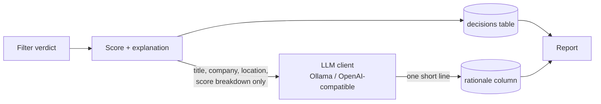

# Architecture

Status: all five stages and the optional LLM layer are built.

jobgate is a five-stage pipeline. Each stage is independently testable and talks to
the next one through plain, typed data.

| # | Stage | Input | Output |
|---|-------|-------|--------|
| 1 | Fetch | company list (YAML) | raw ATS JSON, cached locally |
| 2 | Normalize | raw JSON | `Job` objects |
| 3 | Filter | `Job` + profile | pass / reject / check, with a reason code |
| 4 | Score | passed `Job` + profile + weights | 0-100 score with breakdown |
| 5 | Store + Report | scored jobs | SQLite rows, Markdown and CSV reports |

Core rule: every decision is rule-based. The optional LLM only rewords explanation
text and never influences a filter result or a score.

## Stage 1-2 as built (Phase 1)

- `http.py` - `HttpClient.get_json`: User-Agent, throttle, timeout, retries, daily cache.
- `adapters/base.py` - `Adapter` with `request(token)`, pure `parse(raw, company)` and `fetch(...)`. One malformed posting is skipped, a wrong overall shape raises `FetchError`.
- `adapters/{greenhouse,lever,ashby}.py` - one small class each; `parse` is tested on fixtures.
- `models.py` - the single `Job` schema; `Job.key` (`ats:company:id`) is the de-duplication identity.
- `companies.py` - YAML reader with validation and per-source on/off switches.
- `fetch.py` - `fetch_all` runs every active company; a failure is recorded in the report and the run continues.

## Stage 3 as built (Phase 2): the blocker filter

`profile.py` loads `profile.yaml` (see `profile.example.yaml`). `filters.evaluate(job, profile)`
runs ten independent rules and returns a `Decision`: a verdict (`pass`, `check`, `reject`)
plus a list of reasons, each with a stable code and the sentence that triggered it. Any
`reject` wins over `check`, which wins over `pass`.

| Rule | Reject code | Check code |
|------|-------------|------------|
| Visa / work permit | `VISA_NO_SPONSORSHIP`, `WORK_AUTH_REQUIRED` | `SPONSORSHIP_CONFLICT`, `SPONSORSHIP_LOCATION_UNKNOWN` |
| Citizenship / clearance | `CITIZENSHIP_REQUIRED`, `CLEARANCE_REQUIRED` | |
| Video / take-home | `VIDEO_REQUIRED`, `ASSIGNMENT_REQUIRED` | |
| Years of experience | `EXPERIENCE_TOO_HIGH` | `EXPERIENCE_AMBIGUOUS` |
| Seniority in the title | `SENIORITY_IN_TITLE` (Senior, Sr., Staff Engineer, Principal, Director, VP, Head of) | `SENIORITY_IN_TITLE` (Lead, Architect, Manager) |
| Student status (only if `student_status: graduated`) | `STUDENT_STATUS_REQUIRED` | `GRADUATION_AMBIGUOUS` |
| Graduation year (only if `graduation_year` is set) | `GRADUATION_YEAR_MISMATCH` | `GRADUATION_AMBIGUOUS` |
| Location | `LOCATION_OUTSIDE_PROFILE` | `LOCATION_UNCLEAR` |
| Time zone | `TIMEZONE_OUTSIDE_PROFILE` | |
| Language | `LANGUAGE_NOT_IN_PROFILE` | |

Design choices worth explaining:

- **Sentence-level regexes, no LLM.** Each rule looks at one sentence at a time, so the
  evidence shown to the user is exactly the sentence that triggered the rule.
- **Asking is cheaper than wrongly rejecting.** Wording that could go either way
  (conflicting sponsorship statements, a bare "Remote", a region the user would work in
  but may not be authorized in) becomes `check`, not `reject`.
- **Optional wording is ignored.** Sentences with "plus", "preferred", "nice to have" do not block.
- **A "no sponsorship" sentence only blocks where the user lacks work rights.** In a country
  covered by `work_authorization.regions` it is irrelevant.

`evaluation.py` measures the filter on `tests/data/labeled_postings.csv` and writes
`docs/filter_report.md`. See `docs/labeling.md` for how labels are verified.

## Stage 4-5 as built (Phase 3)

**Scoring (`scoring.py`).** `score_job(job, profile, weights)` returns five integer parts that
add up to the total, so the explanation is exact: `72: role 28, technology 20, level 16, location 8`
(zero parts are omitted). Weights live in YAML (`scoring.example.yaml`) and must add up to 100.

| Part | Max (default) | How it is computed |
|------|---------------|--------------------|
| role | 30 | the title is normalised (case, punctuation, "engineering" -> "engineer", `role_synonyms`) and split into a head and later parts; best tier per target role: whole phrase in the head 1.0, all words in the head 0.9, whole phrase in a later part 0.8, at least half the words in the head up to 0.75, else 0; an avoided word gives 0. The match that counted is stored (`decisions.role_match`) and shown in the report |
| technology | 30 | profile technologies found in title + description; full points at `technology_saturation` matches (default 3) |
| level | 20 | senior title 0, junior/new-grad title full, else the years asked vs. the profile limit |
| location | 10 | 60% place (allowed / unclear / outside) + 40% work mode (remote, hybrid, onsite) |
| compensation | 10 | the posting discloses a pay range |

Only postings that passed the filter (or need a check) are scored; the score never changes a
filter decision, and no LLM is involved.

**Storage (`storage.py`, SQLite).** Everything is keyed by `Job.key`.

| Table | Purpose |
|-------|---------|
| `jobs` | one row per posting; `first_seen`, `last_seen`, `active`; `short_id` is what you type in `mark` |
| `decisions` | latest filter verdict with its reasons (JSON), plus score and breakdown |
| `status_history` | append-only: `found` (automatic, once), then `applied` / `dropped` when you mark it |
| `runs` | one row per fetch (counts and failures); the only table that grows on every run |

Why re-running is safe: jobs and decisions are upserts, `found` is written only when a posting
is first seen, `mark` ignores a status that is already current, and postings that vanish from a
company that was fetched successfully are marked inactive (companies that failed are left alone).

**Report (`report.py`).** Pure functions of the stored rows: ranked matches, "needs a check" with
the triggering sentences, "low role match" and counts of rejection reasons. `is_low_role(row)` is
true for a passing or to-check posting whose stored role part is 0; such a posting is listed under
"Low role match" (score and breakdown shown, role 0 spelled out, filter reasons shown for a
to-check posting) instead of "Ranked matches" or "Needs a check". Only the
report looks at this: the score is still computed and stored, and verdicts and weights are
untouched. A row with no stored breakdown is never low role. The CSV gets a `section` column
(`ranked`, `check`, `low_role_match`, `rejected`) and a `role_points` column; low-role rows follow
the ranked and check rows and have no rank; `verdict` still holds the filter's verdict. Ties break by company then title, so the
same database always gives the same bytes. Postings you marked `dropped` are hidden.

**CLI (`cli.py`, typer).** Global options go before the command (`jobgate --db my.db run`).
`run` = `fetch` → `filter` → `score` → `report`; every step is a function shared with its own
command. Errors are printed as `error: ...` with exit code 2 (bad input) or 1 (nothing fetched).
`check` is the exception: it is not a pipeline step. It builds one `Job` from pasted text, calls
`filters.evaluate` with the profile and prints the decision; it never opens the database, an HTTP
client or an LLM client (a test makes those raise). With no `--location` it drops the
`LOCATION_UNCLEAR` reason, because an empty location is not a finding about the posting.

## Optional LLM layer (Phase 4): `llm.py`

The arrows only go one way: the LLM receives facts that the rules already produced and writes
into its own `rationale` column. Nothing it returns is parsed, so it cannot influence a
verdict or a score.

- **Off by default.** `load_llm_config` returns `enabled: false` when `llm.yaml` does not exist.
  While off, no client is constructed (tested).
- **Clients.** `OllamaClient` posts to `/api/chat` with `stream: false`; `OpenAICompatibleClient`
  posts to `/chat/completions` and reads an optional key from the environment variable named in
  the config. Both turn every network, HTTP and parse failure into `LlmError`.
- **Failure policy.** `write_rationales` never raises. On the first `LlmError` it logs a warning
  and stops, so an absent Ollama costs one timeout, not one per posting; the CLI prints
  `LLM unavailable (...)` and the run continues with the rule-based explanation.
- **Hygiene.** The prompt tells the model to add no facts or numbers; the answer is cut to one
  plain line of at most 300 characters. A rationale is generated once per posting and cleared
  only when the score explanation changes.
- **Tests** use `httpx.MockTransport` and a fake client; the suite never needs Ollama. One test
  runs the whole pipeline with and without a (hostile) fake LLM and compares every verdict,
  reason and score.
